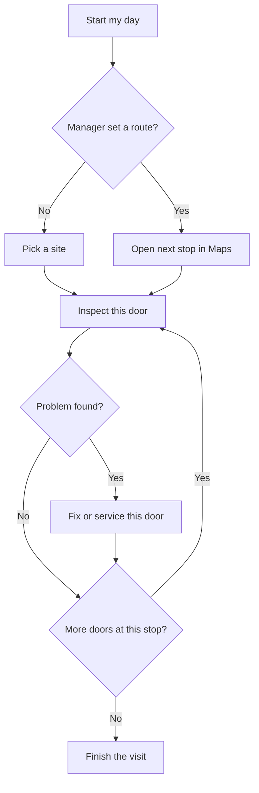

# Opening Intelligence — how the work is organized

One job per screen. A tech can take the phone and start without a training session. The office sets the day. The phone does the door in front of them.

Existing rule, unchanged: a technician or an inspector does not get a dashboard. A person who needs both the phone and an office screen has the manager role.

## Roles

| Role | Goal | Where they work | Task pages |
|---|---|---|---|
| Tech | Do today's doors in the order the manager set, and leave a record that syncs. | Field app | Start my day. Inspect this door. Fix or service this door. Finish the visit. |
| Inspector | Check the doors and sign the result. They do not change hardware. | Field app, same four pages. Fix/service is a request, not an edit. | Start my day. Inspect this door. Ask for service. Finish the visit. |
| Provider manager | Set the day's route, see which stops are done, and send people where the work is. | Provider dashboard (the office app) | Today's route. Stop status. Nearby work. Team for the day. |
| Facility manager / customer admin | Know which doors failed, keep the records, and send purchasing what it needs. | Facility Dashboard | Failed doors. Inspection visits. Door record. Purchasing email. |
| OI staff | Turn a company on or off, and see who covers which facility. No customer data is deleted. | OI staff tools, inside the office app | Companies. Facilities and providers. Parent links. Recognition usage. |

Account tasks (sign in, password, company switch) are not a work role. They live in a small account menu, not on the task pages.

## What stays on the tech screen

The signed-in line, Synchronization review, the build, and the Company picker move into the account menu.

These stay visible on every tech task page:

- Where they are: today's stop, or the door number.
- A sync dot when something is still on the phone. If it is clear, they can ignore it. If it is not, one tap opens Synchronization review.
- One back step to the task they came from. No dead ends.

## Tech day

**Start my day.** The manager's route only. One stop is one site, with that site's doors, time windows, and doors done and left. Open in Maps is only for the next site that still has a door left. Tapping a stop opens that site's door list and continues the one open visit there. A tech does not pick a site. If nothing is scheduled, the page says to check with the manager. A nearby stop is a request until a manager approves it, and it is not on this page. Inspect and Finish the visit are on the site door list.

**Inspect this door.** Scan or type the door. Show the last result in one line. Checklist, photos, sign, Save. If something failed, one line offers Fix this door and returns here afterward. Details holds history, schedules, hardware, door and frame, and request service.

**Fix or service this door.** What you did, a photo if needed, Save. Inspectors send a service request instead of editing the door. The place in the inspection is kept.

**Finish the visit.** The doors from today, each with Passed or Failed. One button sends one report. Nothing is emailed before that tap. Starting a new visit finishes this one and does not send a report.

Hints are one line, in tech words: door, today's doors, stop. A mistake can be undone: Not now, Keep it, or the sync review discard that removes only this phone's copy.

## Where today's buttons go

Nothing is removed. Office-only and setup screens stay behind Details or the account menu.

| Today | New home |
|---|---|
| Scan opening, Look up opening, Change facility | Start my day, or the scan step on Inspect this door |
| Today's route, Open in Maps, Navigate all stops, Mark done, Nearby work, Add to route | Start my day |
| Visit band, This visit count, Finish visit / Send combined report | Finish the visit. The count is the review list, not a second task. |
| Start a new visit, Finish this visit first, Start a new visit anyway, Not now | Finish the visit. Anyway finishes this visit and does not send a report. |
| Log Inspection, checklist, signature, Save | Inspect this door |
| Add an Additional Opening | Next door on Inspect this door |
| Log Service, Log service on a component | Fix or service this door |
| Request service, Review request, Submit request | Fix or service this door for an inspector, or Details for a one-off request |
| Opening record, health, photos, Add hardware, Edit hardware, Identify hardware, Door and frame, Finish the opening, Print / save label | Details |
| Installation and service history, Facility schedules, Replacement / downtime / warranty | Details |
| Facilities and openings, facility list, openings list, Done With This Visit | Start my day when there is no route. The badge stays on the door list inside the stop. |
| Schedule comparison report | Provider manager, not the tech phone |
| My Work Orders | Start my day, as stops the manager already placed |
| Synchronization review, sync dot, Retry, Save a copy, Remove from this device, Discard this saved change, Save without a visit, Save in a new visit | Sync dot on the task page. The review itself is the account menu. |
| Signed-in line, build, Company picker, Change Password, Sign out, How to use | Account menu. How to use stays one tap from sign-in. |
| Sign in, Forgot password, Recover test account, Renew private site access | Sign-in, before any task |
| Choose a location, Continue, Change location | Only when Start my day has no route |
| Facility Dashboard shortcut | Hidden for techs and inspectors. Managers open the office app. |
| QR landing, Sign in for protected details | The door label, before sign-in |
| Company branches | Customer admin, not the tech phone |
| Photo isolation diagnostic | Stays off the tech path |

## What can be reused

| Area | Reuse | New shell |
|---|---|---|
| Start my day | Today's route, Maps links, nearby work, location picker when there is no route | One primary button and the done/left count. The rest of Scan's menu leaves this page. |
| Inspect this door | Scan, opening lookup, NFPA checklist, photos, signature, save, visit binding | Last-result line, and Fix this door without losing the checklist. |
| Fix or service | Log service and request service | A short page with one Save. Hardware edits stay in Details. |
| Finish the visit | Visit page, door list, one email, the confirm card | The list is today's doors. Account chrome is not on this page. |
| Details | Opening page sections, structure, schedules, lifecycle, hardware, label | A drawer, not a new data model. |
| Account menu | Account line, company switch, sync review, password, sign out | A menu opened from a person mark. The sync dot stays on the task page. |
| Office roles | Provider dashboard, Facility Dashboard, OI staff tools | No new products. Task pages are a thinner front on those screens. |

No new tables are required for the four tech pages. Routes, visits, inspections, and service notes already exist. The phone change is which screen is first and which control is the one big button.

## Build plan

Stephan wants this before production launch. Build it behind a staging switch so today's screens stay available until the new path is the one a tech walks. Flag: `OI_TECH_TASKS`, read in the field app as `VITE_OI_TECH_TASKS=true`. Off unless that variable is set at field-app build time. The staging package build (`scripts/build-staging-package-16abbf4.mjs`) sets it for the field app only. Production builds do not set it, and it is not a hosted environment variable. The switch does not change the server.

| Step | What ships | Beside today's screens |
|---|---|---|
| 1 | Switch, sync dot, back, and the account mark. The mark still opens the current account line, company picker, and Synchronization review. | Scan remains one tap away. |
| 2 | Start my day, wrapping today's route, Maps, done/left, and pick-a-site when there is no route. | Today's route and Choose a location stay. |
| 3 | Finish the visit, wrapping the visit door list and the one report email. | The visit page stays. |
| 4 | Inspect this door: scan, last result, checklist, photos, Save, and Fix this door that returns to the same inspection. | Log Inspection and Scan stay. |
| 5 | Fix or service this door: one Save. Inspectors get a request, not a hardware edit. | Log service and request service stay. |
| 6 | Details drawer and the account menu. With the switch on, Scan's button list is no longer home. | Every current screen is still reachable from Details or the account menu. |

**Blocks launch.** The four tech pages, with one primary button each. Start my day works with a manager route and without one. Inspect this door can jump to Fix and come back without losing the checklist. Finish the visit sends one report and does not email before that tap. The sync dot is still visible. A tech or inspector still has no dashboard. The switch has been walked on staging, with today's screens still reachable, before it is the production default.

**Can follow launch.** Thinner task pages for the provider manager, the facility manager, and OI staff. Those office screens already exist. Nearby-work polish. Rearranging the inside of each Details screen. Schedule comparison, company branches, and the photo diagnostic stay off the tech path. None of those block the tech day.
